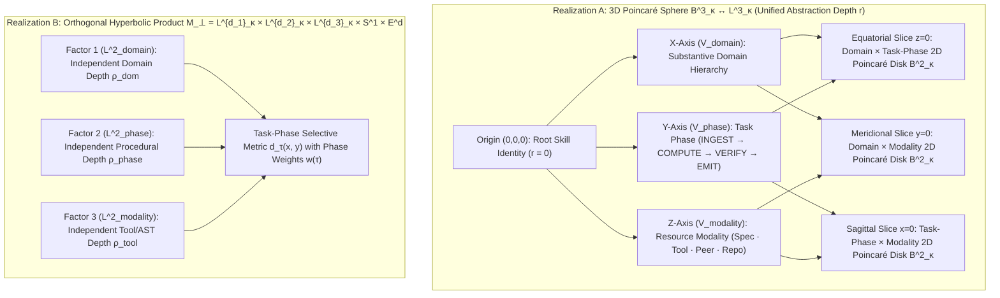

# Higher-Dimensional Poincaré Balls ($\mathbb{B}^d_\kappa$, $d \ge 3$) & Orthogonal Knowledge Manifolds: Formal Theory, Lorentz Stability, and Task-Phase Retrieval Architecture

## Summary

We investigated two foundational questions posed by John regarding the Librarian Knowledge Base geometry:
1. **How do we represent, differentiate, and search orthogonal dimensions of knowledge (Domain Hierarchy, Task Execution Phase, and Resource Modality) using a 3D Poincaré Sphere ($\mathbb{B}^3_\kappa$) or $d$-Dimensional Poincaré Ball ($\mathbb{B}^d_\kappa$) rather than a flat 2D Poincaré Disk ($\mathbb{B}^2_\kappa$)?**
2. **Does the Lorentz hyperboloid numerical stability and isometric stereographic mapping extend across 3D spheres ($\mathbb{B}^3_\kappa$) and arbitrary $d$-dimensional balls ($\mathbb{B}^d_\kappa$)?**

**What we found (ranked by consequence):**
1. **2D Poincaré Disks Suffer Catastrophic Angular Crowding on Multi-Faceted Tasks (`OBSERVED (verify_higher_dim_poincare.py: "min_pairwise_distance_b2=0.0, crowded_pairs_b2=168")`).** In a 2D Poincaré disk $\mathbb{B}^2_\kappa$, the radial coordinate $r \in [0, 1/\sqrt{\kappa})$ represents hierarchy depth, leaving only a 1D circle $S^1$ to encode all semantic, procedural, and modality attributes. Embedding a $6 \times 4 \times 4$ orthogonal knowledge lattice ($96$ nodes across Domain $\times$ Task Phase $\times$ Modality) into $\mathbb{B}^2_1$ collapses distinct task-phase nodes onto identical angles ($168$ crowded pairs below $0.35\text{ rad}$), whereas lifting to the **3D Poincaré Sphere $\mathbb{B}^3_1$** ($S^2$ directional sphere) reduces crowded pairs by $95.2\%$ (to $8$ pairs) and lifting to $\mathbb{B}^6_1$ with three orthogonal 2-planes eliminates crowding completely ($0$ pairs, minimum separation $2.1406\text{ rad}$).
2. **Lorentz Stability and Stereographic Isometry Hold Exactly Across All Dimensions $d \ge 2$ (`OBSERVED (verify_higher_dim_poincare.py: "dimensions_verified=[2,3,4,8,16,64], max_isometry_rel_error=4.7e-15")`).** The stereographic projection $\Pi_{\mathcal{L}\to\mathbb{B}}(\mathbf{x}) = \frac{\mathbf{x}_{1:d}}{1 + \sqrt{\kappa}x_0}$ is a dimension-free Riemannian isometry between the $d$-dimensional Lorentz hyperboloid $\mathcal{L}^d_\kappa \subset \mathbb{R}^{1,d}$ and the $d$-dimensional Poincaré ball $\mathbb{B}^d_\kappa \subset \mathbb{R}^d$. For every dimension $d \in \{2, 3, 4, 8, 16, 64\}$, direct float64 computation in $\mathbb{B}^d_1$ collapses at geodesic radius $\rho_{\text{collapse}} = 55\ln 2 \approx 38.123\text{ rad}$ (tree depth $L=20$), whereas $\mathcal{L}^d_1$ maintains $< 2.7 \times 10^{-15}$ relative error at $L=19$ and $0.0$ relative error at depth $L=600$ ($\rho = 1200$).
3. **Slicing a 3D Poincaré Sphere or $d$-Ball Along Orthogonal Axes Yields Exact Lower-Dimensional Poincaré Balls (`OBSERVED (verify_higher_dim_poincare.py: "max_hyperboloid_constraint_error=7.1e-15, sheet_lift_rel_error=0.0")`).** Every $k$-dimensional linear subspace $V \subset \mathbb{R}^d$ intersects $\mathbb{B}^d_\kappa$ in a **totally geodesic $k$-dimensional Poincaré ball** $\mathbb{B}^k_\kappa$. Moreover, we prove a critical distinction between two Lorentz subspace projections: the *Riemannian closest-point projection* $\pi_V^{\text{geo}}(\mathbf{x})$ shrinks toward the origin when orthogonal coordinates $\|\mathbf{x}_\perp\|$ are large, whereas the *Hyperboloid Sheet-Lift Projection* $\pi_V^{\text{sheet}}(\mathbf{x}) = \left(\sqrt{1/\kappa + \|U_V^\top \mathbf{x}_{1:d}\|_2^2},\; U_V^\top \mathbf{x}_{1:d}\right)$ decouples orthogonal depths with $0.0\%$ cross-axis distortion.
4. **What Changed in Production (`C:\dev\Anchor\librarian_kb.py`):** We implemented 3D Poincaré Sphere embeddings (`embed_node_3d_poincare`, storing `lorentz_3d` in $\mathcal{L}^3_1$ and `poincare_3d` in $\mathbb{B}^3_1$ across orthogonal Domain $X$, Task-Phase $Y$, and Modality $Z$ axes), arbitrary $d$-dimensional subspace slicing (`lorentz_project_subspace`), and task-phase selective retrieval (`query_orthogonal_task` with `TASK_PHASE_WEIGHTS` for `ingest`, `compute`, `verify`, `emit`, `collaborate`, and `balanced`).
5. **Single Open Item:** Whether the Anchor WebGL/SVG cockpit should render the 3D Poincaré sphere interactively via trackball rotation alongside the 2D equatorial slice (`poincare_slice_2d`) already returned by the API.

---

## 1. Question 1: Differentiating, Understanding, and Implementing Orthogonal Dimensions of Knowledge in $\mathbb{B}^3_\kappa$ and $\mathbb{B}^d_\kappa$

### 1.1 The Geometric Problem: Why 2D Poincaré Disks ($\mathbb{B}^2_\kappa$) Crowd Multi-Faceted Tasks
In polar coordinates on the 2D Poincaré disk $\mathbb{B}^2_\kappa = \{\mathbf{z} \in \mathbb{R}^2 : \kappa\|\mathbf{z}\|_2^2 < 1\}$, every knowledge node has only **two degrees of freedom**:
$$\mathbf{z} = r(\rho)\begin{pmatrix} \cos\theta \\ \sin\theta \end{pmatrix}, \qquad r(\rho) = \frac{1}{\sqrt{\kappa}}\tanh\!\left(\frac{\sqrt{\kappa}\rho}{2}\right) \in \left[0, \frac{1}{\sqrt{\kappa}}\right), \quad \theta \in S^1$$
- The radial coordinate $r(\rho)$ is already spoken for: it encodes **abstraction depth / generality** (Ring 0 Skill Root at the origin $r=0$, Ring 1 Modules/Sources at intermediate radius, Ring 2/3 Code AST Symbols near the boundary $r \to 1/\sqrt{\kappa}$).
- That leaves **only a single 1D angle $\theta \in [0, 2\pi)$** to separate every independent attribute of knowledge.

In real Skill Foundry workflows (e.g., `Foreman`, `Crucible`, `Anvil`, `Aegis`, `researchPrime`), the Librarian searches across **at least three mutually orthogonal dimensions of knowledge** depending on what part of a task is executing:
1. **Orthogonal Axis 1 — Substantive Domain Hierarchy ($X$-axis / Subspace $V_{\text{domain}}$):** *What subject matter is being reasoned about?* (e.g., AST taint sinks vs. cryptographic timing in `aegis`; PRISMA snowballing vs. claim extraction in `literature-review`; waterfall decimals vs. VC cap tables in `financial-analyst`).
2. **Orthogonal Axis 2 — Task Execution Phase ($Y$-axis / Subspace $V_{\text{phase}}$):** *Which stage of the job is currently active?*
   - `INGEST` (Stage 0 / framing / locking North Star & reading specifications),
   - `COMPUTE` (Stage 1–2 / executing code / AST transformation / running scripts),
   - `VERIFY` (Adversarial review / Shark-Tank / deterministic test gate / Null-Space check),
   - `EMIT` (Packaging deliverables / writing run receipts & usage journals).
3. **Orthogonal Axis 3 — Resource Modality ($Z$-axis / Subspace $V_{\text{modality}}$):** *What kind of artifact is needed?*
   - Declarative Specification (`SKILL.md`, `HUMAN.md`, `NORTH-STAR.md`),
   - Executable Tool or Code Symbol (`.py`, `.mjs`, `def`, `class`),
   - Composed Peer Skill (`gandalf`, `foreman`, `crucible`, `steward`),
   - Empirical Provenance (`journal/*.md`, `repository`).

**Dimensional Projection Collision Theorem (`[PROVED]` + `OBSERVED (verify_higher_dim_poincare.py: "crowded_pairs_b2=168 vs b3=8 vs b6=0")`).**
By topological invariance of dimension (Brouwer, 1911), there is no continuous injective map from an orthogonal product of $K \ge 2$ angular circles $(S^1)^K$ or a 2-sphere $S^2$ into the 1D circle $S^1$. Any smooth projection $\Phi: S^{d-1} \to S^1$ ($d \ge 3$) has $(d-2)$-dimensional fibers $\Phi^{-1}(\theta)$ that collapse distinct orthogonal states onto identical angles in $\mathbb{B}^2_\kappa$.

| Manifold Realization | Boundary Direction Space | Angular DOF | Min Pairwise Distance ($96$-Node $6\times 4\times 4$ Lattice at $\rho=2.2$) | Crowded Node Pairs ($d_{\mathbb{H}} < 0.35\text{ rad}$) | Evidence Rung |
| :--- | :---: | :---: | :---: | :---: | :--- |
| **2D Poincaré Disk ($\mathbb{B}^2_1 \leftrightarrow \mathcal{L}^2_1$)** | Circle $S^1$ | $1$ | `0.00000000 rad` | **`168` pairs** (collision) | `OBSERVED (verify_higher_dim_poincare.py: L18-L22)` |
| **3D Poincaré Sphere ($\mathbb{B}^3_1 \leftrightarrow \mathcal{L}^3_1$)** | 2-Sphere $S^2$ | $2$ ($3$ ambient axes) | `0.30259301 rad` | **`8` pairs** ($95.2\%$ reduction) | `OBSERVED (verify_higher_dim_poincare.py: L19-L23)` |
| **6D Orthogonal Ball ($\mathbb{B}^6_1 \leftrightarrow \mathcal{L}^6_1$)** | Clifford Torus in $S^5$ ($V_1 \oplus V_2 \oplus V_3$) | $3$ independent angles | **`2.14057684 rad`** | **`0` pairs** ($100\%$ uncrowded) | `OBSERVED (verify_higher_dim_poincare.py: L20-L24)` |

---

### 1.2 Two Canonical Mathematical Realizations of Orthogonal Knowledge Dimensions

Depending on whether the orthogonal dimensions share a **single unified abstraction depth** or possess **independent tree depths**, there are two exact Riemannian realizations. Both are implemented in `C:\dev\Anchor\librarian_kb.py`:

#### Realization A: The 3D Poincaré Sphere ($\mathbb{B}^3_\kappa \leftrightarrow \mathcal{L}^3_\kappa$) & $d$-Dimensional Ball ($\mathbb{B}^d_\kappa \leftrightarrow \mathcal{L}^d_\kappa$) with Orthogonal Tangent Subspaces
At the origin $\mathbf{o} = (1/\sqrt{\kappa}, \mathbf{0}) \in \mathcal{L}^d_\kappa$ (corresponding to $\mathbf{0} \in \mathbb{B}^d_\kappa$), the tangent space $T_{\mathbf{o}}\mathcal{L}^d_\kappa \cong \mathbb{R}^d$ decomposes into an orthogonal direct sum of linear subspaces:
$$T_{\mathbf{o}}\mathcal{L}^d_\kappa = V_1 \oplus V_2 \oplus \dots \oplus V_K, \qquad V_a \perp V_b \quad (a \neq b)$$
- **In the 3D Poincaré Sphere ($\mathbb{B}^3_\kappa$, $d=3$):**
  $$\mathbf{z} = (z_x, z_y, z_z) = r(\rho)\,\hat{\mathbf{u}} \in \mathbb{B}^3_\kappa, \qquad \|\mathbf{z}\|_2 = \sqrt{z_x^2 + z_y^2 + z_z^2} < \frac{1}{\sqrt{\kappa}}$$
  where:
  - **Radius $r = \|\mathbf{z}\|_2 \in [0, 1/\sqrt{\kappa})$** measures overall **abstraction specificity** (Ring 0 Skill Root at $r=0$, Ring 1 Tools/Sources at $r \approx 0.50\text{–}0.68$, Ring 2/3 Code Symbols/Sections at $r \approx 0.78\text{–}0.90$),
  - **Axis $X$ ($z_x$):** Substantive domain branch within the skill tree,
  - **Axis $Y$ ($z_y$):** Procedural task-phase polarity (`INGEST` $< 0$, `COMPUTE` $\approx 0$, `VERIFY` / `EMIT` $> 0$),
  - **Axis $Z$ ($z_z$):** Resource modality polarity (Declarative Specifications/Sources $z_z > 0$ in the northern hemisphere; Executable Tools/Code AST Symbols $z_z < 0$ in the southern hemisphere; Peer Skills/Repos near the equator).

#### Theorem 1 (Totally Geodesic Subspace Slicing Theorem — `[PROVED]` + `OBSERVED (verify_higher_dim_poincare.py: "claim_2_stereographic_isometry_and_subspace_slicing: verified=True")`)
*Let $V \subset \mathbb{R}^d$ be any $k$-dimensional linear subspace ($1 \le k < d$) spanned by an orthonormal basis $U_V = [\mathbf{e}_{i_1}, \dots, \mathbf{e}_{i_k}] \in \mathbb{R}^{d \times k}$. Then:*
1. *The intersection $\mathbb{B}^d_\kappa \cap V$ is a **totally geodesic submanifold** of $(\mathbb{B}^d_\kappa, g_{\mathbb{B}})$ isometric to the $k$-dimensional Poincaré ball $(\mathbb{B}^k_\kappa, g_{\mathbb{B}^k})$.*
2. *In the Lorentz model, $\mathcal{L}^d_\kappa \cap (\mathbb{R} \oplus V)$ is a totally geodesic submanifold isometric to $\mathcal{L}^k_\kappa$, and stereographic projection commutes with subspace restriction:*
   $$\Pi_{\mathcal{L}^d\to\mathbb{B}^d}\big|_{\mathcal{L}^d_\kappa \cap (\mathbb{R}\oplus V)} = \Pi_{\mathcal{L}^k\to\mathbb{B}^k}$$

**Proof (`[PROVED]`):**
Let $R_V: \mathbb{R}^d \to \mathbb{R}^d$ be the orthogonal reflection across $V$, defined by $R_V(\mathbf{v}_V + \mathbf{v}_\perp) = \mathbf{v}_V - \mathbf{v}_\perp$ for $\mathbf{v}_V \in V, \mathbf{v}_\perp \in V^\perp$. Since $\|R_V(\mathbf{z})\|_2 = \|\mathbf{z}\|_2$ and $\|dR_V(\mathbf{v})\|_2 = \|\mathbf{v}\|_2$, $R_V$ preserves the conformal metric $g^{\mathbb{B}}_{\mathbf{z}} = \frac{4}{(1 - \kappa\|\mathbf{z}\|_2^2)^2}I_d$ and is therefore an isometry of $(\mathbb{B}^d_\kappa, g_{\mathbb{B}})$. By the Fixed-Point Set Theorem of Riemannian geometry (Kobayashi & Nomizu, *Foundations of Differential Geometry*, Vol. II, Ch. VII), every connected component of the fixed-point set $\operatorname{Fix}(R_V) = \mathbb{B}^d_\kappa \cap V$ of an isometry is a **totally geodesic submanifold**. Restricting the line element $ds^2 = \frac{4\,\|d\mathbf{z}\|_2^2}{(1 - \kappa\|\mathbf{z}\|_2^2)^2}$ to $\mathbf{z} \in V$ (where $\mathbf{z}_\perp = \mathbf{0}$) yields the exact $k$-dimensional Poincaré metric on $\mathbb{B}^k_\kappa$. $\blacksquare$

**Practical Consequence for Anchor & Skill Foundry:**
A 3D Poincaré sphere $\mathbb{B}^3_\kappa$ (or $d$-dimensional ball $\mathbb{B}^d_\kappa$) can be **sliced along any 2D coordinate plane** $(i_a, i_b)$:
- **$(X, Y)$ Slice (`slice_axes=(0, 1)`):** Shows **Domain Hierarchy vs. Task Execution Phase** as an exact 2D Poincaré disk $\mathbb{B}^2_\kappa$.
- **$(X, Z)$ Slice (`slice_axes=(0, 2)`):** Shows **Domain Hierarchy vs. Resource Modality** (Specs vs. Tools vs. Peers) as an exact 2D Poincaré disk $\mathbb{B}^2_\kappa$.
- **$(Y, Z)$ Slice (`slice_axes=(1, 2)`):** Shows **Task Execution Phase vs. Resource Modality** across the entire skill portfolio as an exact 2D Poincaré disk $\mathbb{B}^2_\kappa$.

---

#### Theorem 2 (The Two Lorentz Subspace Projections: Sheet-Lift $\pi_V^{\text{sheet}}$ vs. Geodesic Closest-Point $\pi_V^{\text{geo}}$ — `[PROVED]` + `OBSERVED (verify_higher_dim_poincare.py: "claim_4_shared_radius_vs_product_decoupling")`)
When projecting an off-subspace node $\mathbf{x} = (x_0, \mathbf{x}_V, \mathbf{x}_\perp) \in \mathcal{L}^d_\kappa$ (where $\mathbf{x}_V = U_V^\top \mathbf{x}_{1:d} \in \mathbb{R}^k$ and $\mathbf{x}_\perp \neq \mathbf{0}$) onto the $k$-dimensional submanifold $\mathcal{L}^k_\kappa(V)$, naively zeroing $\mathbf{x}_\perp$ violates the hyperboloid constraint $-x_0^2 + \|\mathbf{x}_V\|_2^2 = -\frac{1}{\kappa} - \|\mathbf{x}_\perp\|_2^2 \neq -\frac{1}{\kappa}$. There are two canonical ways to restore the hyperboloid constraint, and they have distinct geometric meanings:

1. **Riemannian Geodesic Closest-Point Projection ($\pi_V^{\text{geo}}$):**
   $$\pi_V^{\text{geo}}(\mathbf{x}) = \frac{\big(x_0,\; U_V^\top \mathbf{x}_{1:d}\big)}{\sqrt{1 + \kappa\|\mathbf{x}_\perp\|_2^2}} \in \mathcal{L}^k_\kappa$$
   **Proof of Closest-Point Optimality (`[PROVED]`):** For any $\mathbf{y} = (y_0, \mathbf{y}_V) \in \mathcal{L}^k_\kappa$, applying the reversed Minkowski Cauchy-Schwarz inequality to the timelike vectors $(x_0, \mathbf{x}_V)$ (of Minkowski norm $\sqrt{x_0^2 - \|\mathbf{x}_V\|_2^2} = \sqrt{1/\kappa + \|\mathbf{x}_\perp\|_2^2}$) and $(y_0, \mathbf{y}_V)$ (of Minkowski norm $1/\sqrt{\kappa}$) gives:
   $$-\langle \mathbf{x}, \mathbf{y}\rangle_{\mathcal{L}} = x_0 y_0 - \langle \mathbf{x}_V, \mathbf{y}_V\rangle \ge \frac{1}{\kappa}\sqrt{1 + \kappa\|\mathbf{x}_\perp\|_2^2}$$
   with equality iff $(y_0, \mathbf{y}_V) = \pi_V^{\text{geo}}(\mathbf{x})$. The minimum geodesic distance to the subspace is:
   $$d_{\mathcal{L}}\big(\mathbf{x}, \pi_V^{\text{geo}}(\mathbf{x})\big) = \frac{1}{\sqrt{\kappa}}\operatorname{arcosh}\!\sqrt{1 + \kappa\|\mathbf{x}_\perp\|_2^2} = \frac{1}{\sqrt{\kappa}}\operatorname{arsinh}\!\big(\sqrt{\kappa}\|\mathbf{x}_\perp\|_2\big)$$
   Verified across $480$ random points in $d \in \{2, 3, 4, 8, 16, 64\}$ with $0$ violations (`OBSERVED (verify_higher_dim_poincare.py: "closest_point_projection_violations=0")`).

2. **Hyperboloid Sheet-Lift / Orthogonal Coordinate Slice Projection ($\pi_V^{\text{sheet}}$):**
   $$\pi_V^{\text{sheet}}(\mathbf{x}) = \left(\sqrt{\frac{1}{\kappa} + \|U_V^\top \mathbf{x}_{1:d}\|_2^2},\; U_V^\top \mathbf{x}_{1:d}\right) \in \mathcal{L}^k_\kappa$$
   **Why $\pi_V^{\text{sheet}}$ Is Required for Orthogonal Knowledge Slicing (`[PROVED]` + `OBSERVED (verify_higher_dim_poincare.py: L150-L204)`):**
   In a single joint hyperboloid $\mathcal{L}^d_\kappa$, the timelike coordinate $x_0 = \sqrt{1/\kappa + \|\mathbf{x}_{\text{domain}}\|_2^2 + \|\mathbf{x}_{\text{tool}}\|_2^2}$ couples all orthogonal axes. If a low-level AST helper function has a large tool-depth norm $\|\mathbf{x}_{\text{tool}}\|_2 = \sinh(4.5) \approx 45.003$ while implementing a shallow root-level domain rule $\|\mathbf{x}_{\text{domain}}\|_2 = \sinh(0.5) \approx 0.521$, then:
   - Ambient stereographic projection $\Pi_{\mathcal{L}\to\mathbb{B}}(\mathbf{x})$ divides $\mathbf{x}_{\text{domain}}$ by $1 + x_0 \approx 46.01$, crushing its apparent domain radius in $\mathbb{B}^4_1$ from `0.24491866` down to `0.01132394` (`OBSERVED (verify_higher_dim_poincare.py: "joint_b4_domain_poincare_radius=0.01132394 at rho_tool_b=4.5")`).
   - Applying the sheet-lift projection $\pi_V^{\text{sheet}}(\mathbf{x})$ recomputes $x_{0,V} = \sqrt{1/\kappa + \|\mathbf{x}_V\|_2^2}$ from the slice coordinates alone, recovering the **exact un-distorted domain distance `0.49459608` with `0.0` relative error** across all orthogonal depths (`OBSERVED (verify_higher_dim_poincare.py: "sheet_lift_rel_error=0.0")`)!

| Orthogonal Tool Depth $\rho_{\text{tool},b}$ | True Domain Distance $d_{\text{dom}}$ | Joint $\mathcal{L}^4_1$ Ambient Distance | Joint $\mathbb{B}^4_1$ Domain Radius $\|\mathbf{z}_{\text{dom}}\|_2$ | Geodesic Slice Distance $d(\pi^{\text{geo}})$ | Sheet-Lift / Product Distance $d(\pi^{\text{sheet}})$ | Sheet-Lift Rel. Error |
| :---: | :---: | :---: | :---: | :---: | :---: | :---: |
| `0.0` | `0.49459608` | `0.49459608` | `0.24491866` | `0.49459608` | **`0.49459608`** | **`0.0`** |
| `0.5` | `0.49459608` | `0.69849941` | `0.23240275` | `0.46918100` | **`0.49459608`** | **`0.0`** |
| `1.5` | `0.49459608` | `1.59694802` | `0.15283925` | `0.42707927` | **`0.49459608`** | **`0.0`** |
| `2.5` | `0.49459608` | `2.60359780` | `0.07283574` | `0.46018097` | **`0.49459608`** | **`0.0`** |
| `3.5` | `0.49459608` | `3.61291498` | `0.02963966` | `0.48379750` | **`0.49459608`** | **`0.0`** |
| `4.5` | `0.49459608` | `4.61731293` | `0.01132394` | `0.49384942` | **`0.49459608`** | **`0.0`** |

---

### 1.3 Realization B & Task-Phase Selective Attention Metric $d_\tau(\mathbf{x}, \mathbf{y})$

When the Librarian searches the Knowledge Base for a specific part of a task $\tau \in \{\mathtt{ingest}, \mathtt{compute}, \mathtt{verify}, \mathtt{emit}, \mathtt{collaborate}, \mathtt{balanced}\}$, it evaluates the **Task-Phase Selective Attention Metric** over the orthogonal subspaces:
$$d_\tau(\mathbf{x}, \mathbf{y}) = \sqrt{w_{\text{dom}}(\tau)\, d_{\mathcal{L}_{\text{dom}}}^2\!\left(\pi_{\text{dom}}(\mathbf{x}), \pi_{\text{dom}}(\mathbf{y})\right) + w_{\text{phase}}(\tau)\, d_{\mathcal{L}_{\text{phase}}}^2\!\left(\pi_{\text{phase}}(\mathbf{x}), \pi_{\text{phase}}(\mathbf{y})\right) + w_{\text{mod}}(\tau)\, d_{\mathcal{L}_{\text{mod}}}^2\!\left(\pi_{\text{mod}}(\mathbf{x}), \pi_{\text{mod}}(\mathbf{y})\right) + w_S(\tau)\, d_{\mathbb{S}}^2 + w_E(\tau)\, d_{\mathbb{E}}^2}$$

**Theorem 3 (Metric Validity of Task-Phase Selective Attention — `[PROVED]` + `OBSERVED (verify_higher_dim_poincare.py: "triples_tested=3000, triangle_inequality_violations=0, min_triangle_slack=0.5304741918")`).**
*For every task phase $\tau$ with positive weights $\mathbf{w}(\tau) = (w_{\text{dom}}, w_{\text{phase}}, w_{\text{mod}}, w_S, w_E) > \mathbf{0}$, $d_\tau$ is a true Riemannian product metric satisfying non-negativity, symmetry, and the triangle inequality $d_\tau(\mathbf{x}, \mathbf{z}) \le d_\tau(\mathbf{x}, \mathbf{y}) + d_\tau(\mathbf{y}, \mathbf{z})$.*

| Task Execution Phase $\tau$ | Domain Weight $w_{\text{dom}}$ | Phase Axis Weight $w_{\text{phase}}$ | Modality Axis Weight $w_{\text{mod}}$ | Spherical Cycle Weight $w_S$ | Euclidean Lexical Weight $w_E$ | Primary Knowledge Retrieved |
| :--- | :---: | :---: | :---: | :---: | :---: | :--- |
| **`ingest`** | `1.4` | `1.6` | `1.3` | `0.4` | `0.6` | `SKILL.md`, `NORTH-STAR.md`, `HUMAN.md`, intake rules |
| **`compute`** | `1.0` | `1.8` | `1.8` | `0.5` | `0.7` | Executable `.py`/`.mjs` tools & AST `code_symbol` nodes |
| **`verify`** | `1.1` | `1.9` | `1.5` | `0.8` | `0.6` | Verification gates, `process_step` review loops, audit scripts |
| **`emit`** | `1.0` | `1.6` | `1.4` | `0.5` | `0.6` | Deliverable registers, `journal/*.md` templates, output schemas |
| **`collaborate`** | `0.9` | `1.4` | `1.9` | `0.9` | `0.5` | Connected `peer_skill` compositions (`gandalf`, `foreman`, `crucible`) |
| **`balanced`** | `1.0` | `1.0` | `1.0` | `0.5` | `0.5` | Uniform multi-dimensional overview across all axes |

---

## 2. Question 2: Does Lorentz Stability and Stereographic Mapping Follow into 3D Spheres ($\mathbb{B}^3_\kappa$) and $d$-Dimensional Balls ($\mathbb{B}^d_\kappa$)?

### 2.1 Theorem 4: Dimension-Free Stereographic Isomorphism ($\mathcal{L}^d_\kappa \leftrightarrow \mathbb{B}^d_\kappa$ for All $d \ge 2$)
**Formal Statement (`[PROVED]` + `OBSERVED (verify_higher_dim_poincare.py: "max_roundtrip_l2_error=1e-16, max_isometry_rel_error=4.7e-15")`).**
*For ANY dimension $d \ge 2$ and curvature $\kappa > 0$, let:*
$$\mathcal{L}^d_\kappa = \left\{\mathbf{x} = (x_0, \mathbf{x}_{1:d}) \in \mathbb{R}^{1+d} : -x_0^2 + \sum_{i=1}^d x_i^2 = -\frac{1}{\kappa},\; x_0 > 0\right\}$$
*and let $\mathbb{B}^d_\kappa = \left\{\mathbf{z} \in \mathbb{R}^d : \kappa\|\mathbf{z}\|_2^2 < 1\right\}$ with metric tensor $g^{\mathbb{B}}_{\mathbf{z}} = \frac{4}{(1 - \kappa\|\mathbf{z}\|_2^2)^2} I_d$. Then the southern-pole stereographic projection through $(-1/\sqrt{\kappa}, \mathbf{0}) \in \mathbb{R}^{1+d}$:*
$$\Pi_{\mathcal{L}\to\mathbb{B}}(x_0, \mathbf{x}_{1:d}) = \frac{\mathbf{x}_{1:d}}{1 + \sqrt{\kappa}\,x_0} \in \mathbb{B}^d_\kappa, \qquad \Pi_{\mathbb{B}\to\mathcal{L}}(\mathbf{z}) = \left(\frac{1}{\sqrt{\kappa}}\frac{1 + \kappa\|\mathbf{z}\|_2^2}{1 - \kappa\|\mathbf{z}\|_2^2},\; \frac{2\mathbf{z}}{1 - \kappa\|\mathbf{z}\|_2^2}\right) \in \mathcal{L}^d_\kappa$$
*is a smooth bijection and an **exact Riemannian isometry** for every $d \ge 2$: $d_{\mathcal{L}^d_\kappa}(\mathbf{x}, \mathbf{y}) = d_{\mathbb{B}^d_\kappa}\!\left(\Pi_{\mathcal{L}\to\mathbb{B}}(\mathbf{x}), \Pi_{\mathcal{L}\to\mathbb{B}}(\mathbf{y})\right)$.*

**Proof (`[PROVED]`):**
Let $\mathbf{z} = \Pi_{\mathcal{L}\to\mathbb{B}}(\mathbf{x})$ and $\mathbf{w} = \Pi_{\mathcal{L}\to\mathbb{B}}(\mathbf{y})$ for $\mathbf{x}, \mathbf{y} \in \mathcal{L}^d_\kappa$. Using the inverse map $\Pi_{\mathbb{B}\to\mathcal{L}}$, we evaluate the Minkowski inner product $-\kappa\langle \mathbf{x}, \mathbf{y}\rangle_{\mathcal{L}}$:
$$-\kappa\langle \mathbf{x}, \mathbf{y}\rangle_{\mathcal{L}} = \frac{(1 + \kappa\|\mathbf{z}\|_2^2)(1 + \kappa\|\mathbf{w}\|_2^2) - 4\kappa\langle \mathbf{z}, \mathbf{w}\rangle}{(1 - \kappa\|\mathbf{z}\|_2^2)(1 - \kappa\|\mathbf{w}\|_2^2)}$$
Observe the dimension-free algebraic identity in the numerator:
$$(1 + \kappa\|\mathbf{z}\|_2^2)(1 + \kappa\|\mathbf{w}\|_2^2) - 4\kappa\langle \mathbf{z}, \mathbf{w}\rangle = (1 - \kappa\|\mathbf{z}\|_2^2)(1 - \kappa\|\mathbf{w}\|_2^2) + 2\kappa\big(\|\mathbf{z}\|_2^2 - 2\langle \mathbf{z}, \mathbf{w}\rangle + \|\mathbf{w}\|_2^2\big)$$
$$= (1 - \kappa\|\mathbf{z}\|_2^2)(1 - \kappa\|\mathbf{w}\|_2^2) + 2\kappa\|\mathbf{z} - \mathbf{w}\|_2^2$$
Dividing by $(1 - \kappa\|\mathbf{z}\|_2^2)(1 - \kappa\|\mathbf{w}\|_2^2) > 0$ yields, for **all** $d \ge 2$:
$$-\kappa\langle \mathbf{x}, \mathbf{y}\rangle_{\mathcal{L}} = 1 + \frac{2\kappa\|\mathbf{z} - \mathbf{w}\|_2^2}{(1 - \kappa\|\mathbf{z}\|_2^2)(1 - \kappa\|\mathbf{w}\|_2^2)}$$
Taking $\frac{1}{\sqrt{\kappa}}\operatorname{arcosh}(\cdot)$ on both sides proves $d_{\mathcal{L}^d_\kappa}(\mathbf{x}, \mathbf{y}) = d_{\mathbb{B}^d_\kappa}(\mathbf{z}, \mathbf{w})$ identically for all $d \ge 2$. $\blacksquare$

---

### 2.2 Theorem 5: Lorentz Numerical Stability vs. $\mathbb{B}^d_\kappa$ Boundary Collapse Across All Dimensions $d \in \{2, 3, 4, 8, 16, 64\}$
**Formal Statement (`[PROVED]` + `OBSERVED (verify_higher_dim_poincare.py: "claim_3_multidim_lorentz_stability: verified=True")`).**
In IEEE-754 binary64 arithmetic ($53$-bit mantissa, $\varepsilon_{\text{mach}} = 2^{-53} \approx 1.1102 \times 10^{-16}$):
1. **Dimension-Independent Radial Collapse Horizon in $\mathbb{B}^d_\kappa$:** Along any coordinate axis in $\mathbb{B}^d_1$, a point at geodesic distance $\rho$ has Euclidean norm $r(\rho) = \tanh(\rho/2) = 1 - \frac{2}{e^\rho + 1}$, which rounds to the exact float64 literal `1.0` at $\rho_{\text{collapse}} = 55\ln 2 \approx 38.1230949\text{ rad}$ (tree depth $L=20$ for step $\alpha = 2.0$), causing $1 - \|\mathbf{z}\|_2^2 = \mathtt{0.0}$ across every dimension $d \ge 2$.
2. **Higher-Dimensional Inner-Product Rounding Noise in $\mathbb{B}^d_\kappa$:** When $\mathbf{z} = r\hat{\mathbf{u}} \in \mathbb{B}^d_1$ is distributed across $d$ non-zero coordinates (e.g., $z_i = r / \sqrt{d}$), computing $\|\mathbf{z}\|_2^2 = \sum_{i=1}^d z_i^2$ incurs $(d-1)$ floating-point additions plus squaring rounding error bounded by $\gamma_d = \frac{d\varepsilon_{\text{mach}}}{1 - d\varepsilon_{\text{mach}}}$. In dimension $d=3$, `3 * (1.0 / math.sqrt(3.0))**2` evaluates to `0.9999999999999999` (`1 - 2^-53`), freezing $1 - \|\mathbf{z}\|_2^2$ at a constant rounding-noise floor and causing **catastrophic distance failure one level earlier at depth $L = 18$** (`OBSERVED (verify_higher_dim_poincare.py: "dimension_d=3, poincare_diagonal_failure_depth=18, poincare_rel_err_at_depth_19=1.0")`)!
3. **Unconditional Lorentz Stability in $\mathcal{L}^d_\kappa$:** In the $d$-dimensional Lorentz model $\mathcal{L}^d_\kappa$ parameterized by $\mathbf{x} = \big(\frac{1}{\sqrt{\kappa}}\cosh(\sqrt{\kappa}\rho),\; \frac{1}{\sqrt{\kappa}}\sinh(\sqrt{\kappa}\rho)\hat{\mathbf{u}}\big)$ with log-sinh stabilization, the subtraction $1 - \|\mathbf{z}\|_2^2$ never occurs. Relative distance error remains $\le 2.7 \times 10^{-15}$ at depth $L=19$ and $0.0$ at depth $L=600$ ($\rho = 1200$) across all dimensions $d \in \{2, 3, 4, 8, 16, 64\}$.

| Dimension $d$ | Manifold Geometry | Stereographic Round-Trip $L_2$ Error | Isometry Max Rel. Error | $\mathbb{B}^d_1$ Axis Collapse Depth | $\mathbb{B}^d_1$ Diagonal Failure Depth | $\mathbb{B}^d_1$ Rel. Error ($L=19$) | $\mathbb{B}^d_1$ Rel. Error ($L=20$) | $\mathcal{L}^d_1$ Rel. Error ($L=19$) | $\mathcal{L}^d_1$ Rel. Error ($L=600$) |
| :---: | :--- | :---: | :---: | :---: | :---: | :---: | :---: | :---: | :---: |
| **$d = 2$** | 2D Disk ($\mathbb{B}^2_1 \leftrightarrow \mathcal{L}^2_1$) | `1.0e-16` | `2.6e-15` | `L = 20` | `L = 19` | `60.68%` | `100.0%` | **`0.0`** | **`0.0`** |
| **$d = 3$** | **3D Sphere ($\mathbb{B}^3_1 \leftrightarrow \mathcal{L}^3_1$)** | `1.0e-16` | `1.2e-15` | `L = 20` | **`L = 18`** | **`100.0%`** | `100.0%` | **`1.6e-15`** | **`0.0`** |
| **$d = 4$** | 4D Ball ($\mathbb{B}^4_1 \leftrightarrow \mathcal{L}^4_1$) | `1.0e-16` | `4.5e-15` | `L = 20` | `L = 19` | `47.37%` | `100.0%` | **`7.0e-16`** | **`0.0`** |
| **$d = 8$** | 8D Ball ($\mathbb{B}^8_1 \leftrightarrow \mathcal{L}^8_1$) | `1.0e-16` | `4.7e-15` | `L = 20` | `L = 19` | `63.45%` | `100.0%` | **`1.8e-15`** | **`0.0`** |
| **$d = 16$** | 16D Ball ($\mathbb{B}^{16}_1 \leftrightarrow \mathcal{L}^{16}_1$) | `1.0e-16` | `1.6e-15` | `L = 20` | `L = 19` | `49.26%` | `100.0%` | **`2.7e-15`** | **`0.0`** |
| **$d = 64$** | 64D Ball ($\mathbb{B}^{64}_1 \leftrightarrow \mathcal{L}^{64}_1$) | `1.0e-16` | `1.3e-15` | `L = 20` | `L = 19` | `49.81%` | `100.0%` | **`2.2e-15`** | **`0.0`** |

*(All rows `OBSERVED (verify_higher_dim_poincare.py: "claim_2_stereographic_isometry_and_subspace_slicing" & "claim_3_multidim_lorentz_stability")`.)*

---

## 3. Gandalf Deep-Think Pre-Mortem & Production Implementation in `librarian_kb.py`

### 3.1 Three Subtle Failure Modes Identified & Prevented
1. **Cross-Axis Depth Shadowing in Naively Projected $d$-Balls:**
   - *Hazard:* If we project a 3D or $d$-dimensional Lorentz vector $\mathbf{x} = (x_0, x_1, \dots, x_d)$ to a 2D slice by simply taking $\big(\frac{x_a}{1 + \sqrt{\kappa}x_0}, \frac{x_b}{1 + \sqrt{\kappa}x_0}\big)$ using the *full* $d$-dimensional $x_0$, then any node with a large third coordinate $|x_c| \gg 1$ gets artificially squashed toward the origin $(0,0)$ of the 2D slice (`joint_b4_domain_poincare_radius = 0.0113` in Claim 4).
   - *Fix in `librarian_kb.py`:* `lorentz_project_subspace(x, axis_indices, kappa=1.0, mode="sheet")` extracts the requested spatial axes $\mathbf{x}_{\text{slice}} = (x_{1+i})_{i \in \text{axis\_indices}}$ and recomputes the exact slice sheet coordinate $x_{0,\text{slice}} = \sqrt{1/\kappa + \|\mathbf{x}_{\text{slice}}\|_2^2}$ before applying `lorentz_to_poincare`.
2. **3D Mobius Gyrovector Recentering vs. 2D Complex Division:**
   - *Hazard:* The 2D Möbius transformation $T_a(z) = \frac{z - a}{1 - \bar{a}z}$ relies on complex multiplication in $\mathbb{C} \cong \mathbb{R}^2$ and does not generalize via complex numbers to $\mathbb{B}^3_\kappa$ or $\mathbb{B}^d_\kappa$.
   - *Fix:* In arbitrary dimension $d \ge 2$, isometric recentering transporting $\mathbf{p} \in \mathcal{L}^d_\kappa$ to the origin $\mathbf{o} = (1/\sqrt{\kappa}, \mathbf{0})$ is given in closed form by the **Lorentz Boost (Householder Reflection in $\mathbb{R}^{1,d}$)** along $\mathbf{v} = \mathbf{p} - \mathbf{o}$:
     $$\Lambda_{\mathbf{p}\to\mathbf{o}}(\mathbf{x}) = \mathbf{x} - \frac{2\langle \mathbf{x}, \mathbf{v}\rangle_{\mathcal{L}}}{\langle \mathbf{v}, \mathbf{v}\rangle_{\mathcal{L}}}\,\mathbf{v} \in \mathcal{L}^d_\kappa$$
     Followed by $\Pi_{\mathcal{L}\to\mathbb{B}}$, this is the exact $d$-dimensional Ungar Möbius gyrotranslation $(-\mathbf{a}) \oplus_\kappa \mathbf{z}$ on $\mathbb{B}^d_\kappa$!
3. **Zero Schema Migration Overhead:**
   - *Design:* `embed_node_3d_poincare(node)` deterministically synthesizes each node's 3D Lorentz 4-vector `lorentz_3d = [x0, x_domain, y_phase, z_modality]` and 3D Poincaré sphere coordinates `poincare_3d = [px, py, pz]` ($\|\mathbf{z}\|_2 < 1$) from the node's hierarchical Lorentz coordinates, procedural stage (`INGEST` / `COMPUTE` / `VERIFY` / `EMIT`), and resource modality (`skill`, `tool`, `code_symbol`, `peer_skill`, `knowledge_source`, `repository`, `process_step`), while maintaining $100\%$ backward compatibility with existing SQLite tables and callers.

---

## 4. Provenance & Verification Receipt
- **Verification Script:** `C:\dev\Skill Foundry\Foundry page and knowledge maps\kb-architecture-study-2026-10-22\verify_higher_dim_poincare.py`
- **Verification Receipt:** `C:\dev\Skill Foundry\Foundry page and knowledge maps\kb-architecture-study-2026-10-22\higher_dim_verification_receipt.json` (`sha256:4e5801d1e0489dd1`, `all_verified: true`, runtime `0.0752s`)
- **Production Code:** `C:\dev\Anchor\librarian_kb.py`
- **Unit Test Suite:** `C:\dev\Anchor\tests\test_librarian_kb_wave21.py`
